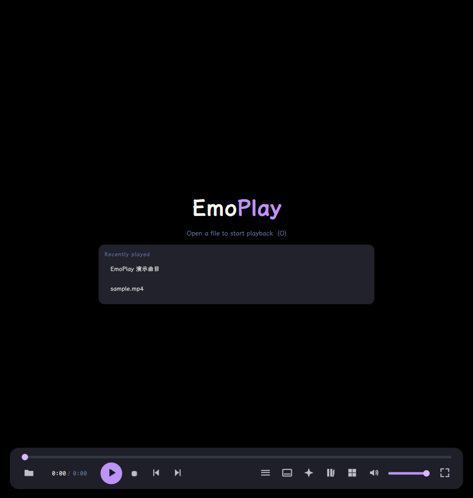
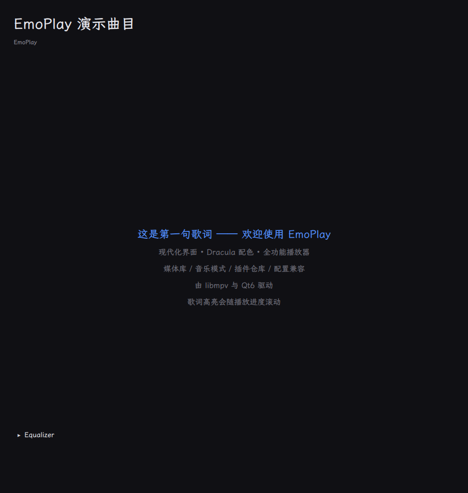

<div align="center">


**A modern cross-platform media player built on libmpv and Qt6/QML**

[](https://github.com/emoeem/mpv-emo/actions/workflows/ci.yml)
[](https://github.com/emoeem/mpv-emo/releases)
[](https://github.com/emoeem/mpv-emo/releases)
[](LICENSE)

*Dracula palette · vector icons · synced lyrics · adaptive quality · plugin store*

[English](README.en.md) | [简体中文](README.md)

</div>

---

## ✨ Features

| | |
|---|---|
| 🎬 **Playback core** | Full-format decoding via libmpv, audio/subtitle track switching, external subtitles, playlists, resumable history |
| 🎨 **Quality engine** | Content-adaptive tiers (anime/live × SD/HD/4K), Anime4K/SSimSuperRes shader groups, HDR tone-mapping, automatic downgrade on dropped frames, frame interpolation (VapourSynth) and ICC display profiles |
| 🖼️ **Media library** | Multi-folder scanning (worker thread), thumbnails (ffmpeg-probed, hashed cache), search & filter |
| 🎵 **Music mode** | Automatic pure-audio mode, .lrc lyrics with line-by-line highlighting, 10-band visual equalizer with presets |
| 🧩 **Plugin store** | manager.json-compatible manifests, builtin + online sources, install/update/uninstall — **local customizations are never overwritten** |
| ⚙️ **Config compat** | First-run scan of `~/.config/mpv` (mpv.conf / input.conf / profiles), import wizard (full/selective/standalone), native script loading, **never writes to your mpv directory** |
| 🔄 **Auto-update** | GitHub Releases check with badge — never auto-installs |
| 🖥️ **Three platforms** | Linux AppImage / Windows portable zip / macOS dmg, built automatically by CI |

## 📷 Screenshots

| Player (idle) | Music mode (lyrics + EQ) |
|---|---|
|  |  |

## 🚀 Getting started

Download the latest build for your platform from the
[releases page](https://github.com/emoeem/mpv-emo/releases/latest) — Linux
AppImage, Windows portable zip, or macOS dmg.

Build from source (Ubuntu 24.04 example):

```bash
sudo apt install build-essential cmake ninja-build pkg-config \
    qt6-base-dev qt6-declarative-dev libmpv-dev \
    libgl1-mesa-dev libegl1-mesa-dev \
    qml6-module-qtquick-controls qml6-module-qtquick-layouts \
    qml6-module-qtquick-window qml6-module-qtquick-dialogs \
    qml6-module-qtquick-templates qml6-module-qtqml-workerscript \
    qml6-module-qtquick-shapes qml6-module-qt-labs-platform

cmake -S . -B build -G Ninja -DCMAKE_BUILD_TYPE=Release
cmake --build build
./build/bin/emoplay path/to/media.mp4
ctest --test-dir build --output-on-failure
```

## 📚 Documentation

Full documentation is in [docs/](docs/) and the
[Chinese README](README.md) covers the project in more depth:
[architecture](docs/architecture.md) · [roadmap](docs/roadmap.md) ·
[backlog](docs/backlog.md) · [testing report](docs/testing-report.md) ·
[CHANGELOG](CHANGELOG.md)

## 📄 License

EmoPlay is [MIT](LICENSE) licensed. libmpv is LGPLv2.1+ and dynamically
linked. Upstream shaders and scripts keep their own licenses.
