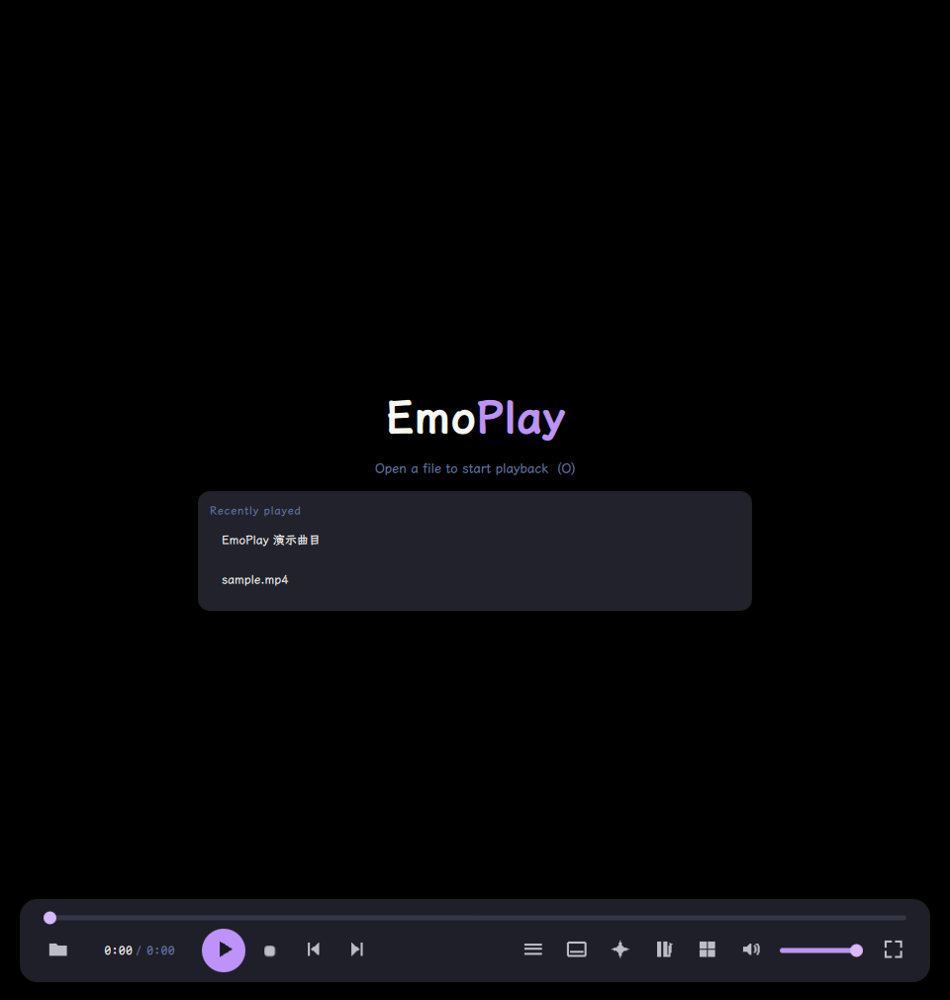
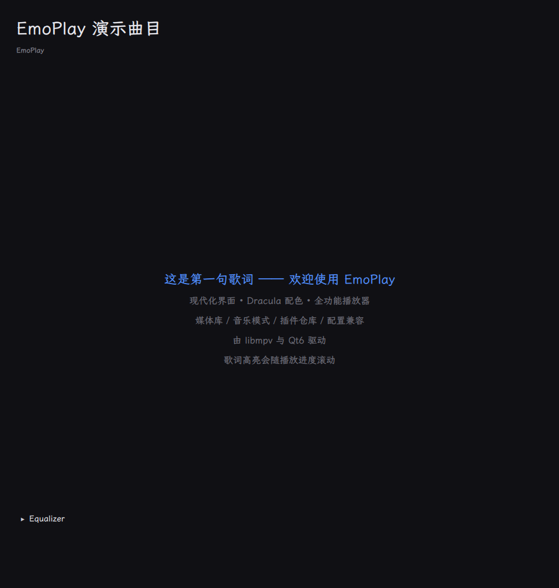

<div align="center">


**基于 libmpv 与 Qt6/QML 的现代跨平台媒体播放器**

[](https://github.com/emoeem/mpv-emo/actions/workflows/ci.yml)
[](https://github.com/emoeem/mpv-emo/releases)
[](https://github.com/emoeem/mpv-emo/releases)
[](https://www.qt.io/)
[](https://mpv.io/)
[](LICENSE)

*Dracula 配色 · 矢量图标 · 歌词高亮 · 自适应画质 · 插件仓库*

[English](README.en.md) | 简体中文

</div>

---

## ✨ 特性一览

| | |
|---|---|
| 🎬 **播放核心** | libmpv 全格式解码、音轨/字幕切换、外挂字幕加载、播放列表、历史断点续播 |
| 🎨 **画质引擎** | 内容自适应画质档位（动画/真人 × SD/HD/4K）、Anime4K/SSimSuperRes 着色器组挂载、HDR tone-mapping、掉帧自动降档、帧插值（VapourSynth 外部依赖）与 ICC 显示配置 |
| 🖼️ **媒体库** | 多目录扫描（后台线程）、缩略图（ffmpeg 探测 + 哈希缓存）、搜索过滤 |
| 🎵 **音乐模式** | 纯音频自动切换、.lrc 歌词逐行高亮滚动、10 段可视化均衡器 + 预设 |
| 🧩 **插件仓库** | manager.json 兼容清单、内置目录 + 在线源（QNetwork 抓取）、安装/更新/卸载、**本地定制永不覆盖** |
| ⚙️ **配置兼容** | 首启扫描 `~/.config/mpv`（mpv.conf / input.conf / profiles）、导入向导（完整/选择性/独立）、脚本原生化加载、**绝不写用户 mpv 目录** |
| 🔄 **自动更新** | GitHub Releases 检查 + 角标提示，绝不自动安装 |
| 🖥️ **三平台发布** | Linux AppImage / Windows 便携 zip / macOS dmg，CI 自动构建 |

## 📷 截图

| 播放器主界面（空闲） | 音乐模式（歌词 + EQ） |
|---|---|
|  |  |

<details>
<summary><b>⌨️ 默认快捷键</b>（可经 input.conf 导入扩展）</summary>

| 按键 | 动作 | 按键 | 动作 |
|---|---|---|---|
| `Space` | 播放/暂停 | `O` | 打开文件 |
| `←` / `→` | 快退/快进 5s | `T` | 音轨/字幕面板 |
| `↑` / `↓` | 音量 ±5 | `S` | 加载外挂字幕 |
| `M` | 静音 | `<` / `>` | 播放列表上一项/下一项 |
| `F` | 全屏 | `Q` | 退出 |

</details>

## 🚀 快速开始

### 下载安装

| 平台 | 资产 | 说明 |
|---|---|---|
| Linux | [AppImage](https://github.com/emoeem/mpv-emo/releases/latest) | 单文件运行，无需安装 |
| Windows | [便携 zip](https://github.com/emoeem/mpv-emo/releases/latest) | 解压即用 |
| macOS | [dmg](https://github.com/emoeem/mpv-emo/releases/latest) | 未签名，首次打开右键 → 打开 |

> 当前版本为 **v1.0**。Windows 签名与 macOS 公证需要证书，尚未部署。

### 从源码构建

```bash
# 依赖（Ubuntu 24.04 为例）
sudo apt install build-essential cmake ninja-build pkg-config \
    qt6-base-dev qt6-declarative-dev libmpv-dev \
    libgl1-mesa-dev libegl1-mesa-dev \
    qml6-module-qtquick-controls qml6-module-qtquick-layouts \
    qml6-module-qtquick-window qml6-module-qtquick-dialogs \
    qml6-module-qtquick-templates qml6-module-qtqml-workerscript \
    qml6-module-qtquick-shapes qml6-module-qt-labs-platform

# 构建
cmake -S . -B build -G Ninja -DCMAKE_BUILD_TYPE=Release
cmake --build build

# 运行 / 测试
./build/bin/emoplay path/to/media.mp4
ctest --test-dir build --output-on-failure
```

## 🏗️ 架构

```
┌────────────────────────────────────────────────┐
│ UI 层 (QML)  主题单例 · 矢量图标 · 抽屉组件      │
├────────────────────────────────────────────────┤
│ 服务层 (C++/Qt)                                 │
│  MpvItem   视频渲染控件（状态镜像给 QML）        │
│  MpvEngine libmpv 封装（命令/属性/事件泵）        │
│  Quality / Music / Library / Plugin / Compat    │
├────────────────────────────────────────────────┤
│ 引擎适配层  mpv render API + QQuickFramebufferObject │
├────────────────────────────────────────────────┤
│ FFmpeg 解码 · libplacebo 渲染 · 系统音频         │
└────────────────────────────────────────────────┘
```

设计原则与线程模型见 [docs/architecture.md](docs/architecture.md)。

## 📚 文档

- [架构设计](docs/architecture.md) · [技术选型](docs/tech-selection.md)
- [路线图](docs/roadmap.md) · [优化 Backlog](docs/backlog.md)
- [原生化计划](docs/nativeization-plan.md)（mpv 脚本能力 → 原生功能映射）
- [测试报告](docs/testing-report.md) · [执行记录](docs/execution-log.md) · [CHANGELOG](CHANGELOG.md)

## 🗺️ 路线图

- [x] P0–P4：选型/架构、libmpv 嵌入、播放器 UI、核心播放、配置兼容
- [x] P5–P8：画质引擎、媒体库、音乐模式、插件仓库（v1 范围）
- [x] P9–P10：三平台打包发布、自动化测试、v1.0 发布
- [ ] R1–R6：全面优化（Qt 6.8 矩阵、OSD/日志、SQLite、i18n、ASAN、信任模型）— [backlog](docs/backlog.md)

## 🙏 致谢

- [mpv](https://mpv.io/) / libmpv — 最好的播放内核
- [Qt](https://www.qt.io/) — 跨平台 UI 框架
- [Anime4K](https://github.com/bloc97/Anime4K)、[hdr-toys](https://github.com/natural-harmonia-gropius/hdr-toys) — 着色器生态
- [mpv-Emo](https://github.com/emoeem/mpv) — 本项目原生化的需求来源与灵感
- Dracula 配色 — [draculatheme.com](https://draculatheme.com/)

## 📄 许可证

EmoPlay 代码以 [MIT](LICENSE) 发布。libmpv 为 LGPLv2.1+，本项目动态链接。第三方着色器与脚本生态保留各自许可。

<div align="center">
<sub>用 libmpv 与 Qt6 构建，为喜欢折腾的播放器用户 ❤️</sub>
</div>
