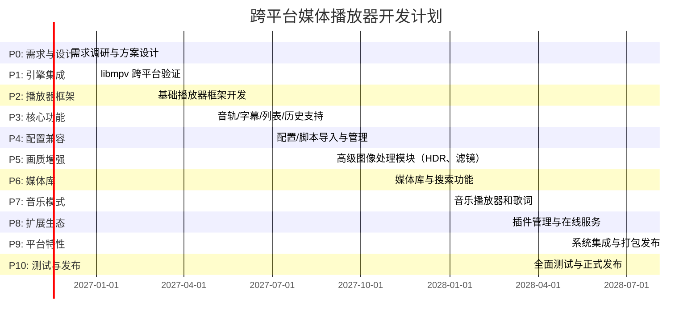

# 执行摘要

本项目旨在从零开发一款基于 **libmpv** 的跨平台桌面播放器（Windows/macOS/Linux），其功能等同或超越现有 mpv 配置与 Mpv-infinity。目标是将 mpv 强大的播放能力与脚本生态融入一个完整的桌面应用：支持视频、音频播放，媒体库管理，高级画质增强，字幕与音轨控制，在线媒体和插件扩展等功能，同时提供统一、美观、可配置的 GUI 界面。我们将充分保留原有 mpv 的所有高级功能和脚本扩展能力，并按模块化、跨平台、性能优先的原则设计架构。项目将分为多个阶段推进（P0–P10），每阶段定义明确的目标、交付物和验收标准，并制定详细的时间表、人员和资源估算。我们还将针对三平台的 GPU 渲染和硬件解码进行调研与验证，设计 mpv 兼容层以导入现有配置和脚本，并提出安全的插件机制。测试计划包括自动化测试、手工测试、性能监测和跨平台兼容性测试；发布流程涉及多平台打包、自动更新及版本兼容策略。此外，将考虑开源许可合规性（避免使用 Mpv∞ 非开源代码）并估算开发成本和风险缓解方案。  

## 项目目标与范围

- **核心功能**：继承并保留当前 mpv 配置和生态的所有功能，包括定制控制界面、播放列表、章节跳转、音轨/字幕选择、多字幕处理、ASS 样式字幕、在线字幕搜索（如 Whisper）、实时字幕翻译、硬件加速解码（DXVA2/D3D11VA/NVDEC、VAAPI/VDPAU/VDPau、VideoToolbox 等）、GPU 画面渲染（OpenGL/Vulkan/Direct3D/Metal）、HDR 管线（PQ/HLG 映射、色彩管理）、多样化图像处理滤镜（Anime4K、FSRCNNX、去色带、锐化、降噪、上采样）、帧插值（RIFE、外部补帧工具）、音频均衡、音效插件、在线弹幕（Bilibili、全网弹幕）、SponsorBlock 跳过、直播画质调整、历史/收藏/书签管理、Trakt 同步、截图/GIF 导出、360° 视频、睡眠定时、远程控制（Web UI）等。几乎所有现有 mpv 脚本（Lua/JavaScript）、着色器、配置文件都必须兼容。  
- **媒体库和音乐**：集成文件浏览、媒体库（封面显示、分类、搜索、筛选）、播放队列和最近播放等功能；单独的音乐播放器界面，支持专辑/艺人浏览、无缝播放、歌词显示、均衡器、音量增强等。  
- **可扩展性**：支持插件和扩展体系，包括 mpv Lua/JS 脚本、GLSL 着色器、VapourSynth 脚本、外部工具集成以及网络服务（Jellyfin 客户端、在线字幕源、音频源、Python/VPN 等）。提供插件安装、启用/禁用、更新和依赖管理。  
- **保留脚本生态**：原生支持 mpv 脚本机制，用户可以照常编辑 `scripts/`、`script-opts/`、`fonts/` 等目录，应用将管理并在运行时加载脚本；同时提供图形化脚本配置界面，但不限制脚本能力。  
- **现有配置迁移**：首次启动时扫描 `~/.config/mpv`（或 Windows 下相应目录）下的 `mpv.conf`、`input.conf`、`profiles.conf` 及脚本目录，识别用户配置、快捷键、脚本及依赖，提供导入选项，或以“独立模式”并行使用。保持原有用户配置的兼容性。  

项目不局限于 mpv 原有的 GUI 包装，而是打造一个完整桌面应用：图形化播放器界面、媒体库、设置中心、插件管理等模块化界面。最终产品应独立安装、启动，无需用户预先安装 mpv；同时需保留 mpv **开放** 的特点：允许命令行使用 `mpv`，编辑原生配置文件，直接执行 mpv 命令和脚本。  

## 关键设计原则

1. **引擎与界面分离**：采用 libmpv 作为播放引擎，通过其 C API 嵌入到应用。应用层仅负责 UI、配置管理和用户交互，所有播放、解码、渲染由 libmpv（及其底层的 FFmpeg 和 libplacebo）处理。用户操作（如切换视频输出、加载着色器、调整参数）最终映射为对 libmpv 属性或命令的调用。  
2. **跨平台一致性**：统一实现 Windows、macOS、Linux 三个平台的体验。使用跨平台框架管理窗口、输入、GPU 上下文等，并针对每个平台的音频输出和硬件解码做本地适配（例如 Windows 使用 WASAPI + D3D11VA/NVDEC，macOS 使用 CoreAudio + VideoToolbox，Linux 使用 PulseAudio/ALSA/PipeWire + VAAPI/Vulkan/NVDEC）。所有平台的 GUI 布局、皮肤风格保持一致。  
3. **可配置与可扩展**：保留 mpv 的高度可定制性。提供集中设置界面，但不封闭功能。高级选项和自定义配置（直接编辑 mpv.conf 或输入 mpv 命令）依然可用。插件/脚本在运行时加载，应用提供沙箱或权限管理，第三方插件无法随意访问用户文件系统或网络。  
4. **性能优先**：尽量利用硬件加速和 GPU 资源，保持播放器轻量高效。尽管引入完整 GUI，播放性能不得比原生 mpv 大幅下降。我们将使用 GPU 渲染（libplacebo/Vulkan/DirectX/Metal）而非软件回退，以保证 4K/HDR 视频流畅播放。  
5. **安全与可靠**：自动化构建、严格测试，减少稳定性回归风险。脚本和插件隔离，避免恶意代码影响。遵循开源许可，明确第三方组件版权和协议，避免使用 Mpv∞ 非开源代码。  

## 技术架构

项目将分四层设计：

```
应用 UI 层 (Qt6/QML 或 Rust UI/Flutter/Electron 等)
├─ 播放器服务层 (播放控制、媒体管理、配置管理、插件管理)
│   ├─ mpv Compatibility Layer (配置导入/同步、脚本加载、IPC)
│   └─ 播放逻辑 (调用 libmpv 命令/属性)
├─ libmpv 引擎适配层 (libmpv C API 集成层)
│   ├─ mpv_command / mpv_set_option / mpv_observe_property
│   └─ mpv_render_context / GPU 纹理交换
└─ 媒体底层
    ├─ FFmpeg 解码 (支持各种编码)
    ├─ libplacebo 渲染 (高质量滤镜、HDR、着色器)
    ├─ GPU 渲染 API (OpenGL/Vulkan/Direct3D/Metal)
    └─ 系统音频 (WASAPI/CoreAudio/ALSA/PulseAudio)

```

我们需要选择一个跨平台 GUI 框架并进行比较，候选项包括 Qt6/QML、Rust（egui/GPUI）、Flutter、Electron 等。下面表格对比了各方案的语言、渲染机制、许可和优劣点，供决策参考：

| 技术栈         | 语言/框架                                   | 渲染方式           | 许可           | 优点                                                                                 | 缺点 / 实现难度                                                                                                                             |
|:-------------|:----------------------------------------|:----------------|:-------------|:----------------------------------------------------------------------------------|:--------------------------------------------------------------------------------------------------------------------------------------|
| **Qt6 / QML**  | C++/QML                                   | Qt Quick Scene Graph (Qt RHI: Metal/Vulkan/Direct3D) | LGPLv3/商业 | 业界成熟、性能卓越、本地渲染、跨平台一致性高；支持 GPU 加速（OpenGL/Vulkan/Metal）；丰富组件和设计器；商业支持丰富。 | C++ 开发难度高（内存管理、信号槽等）；应用体积中等；需要处理 Qt 许可证（动态链接LGPL或购商业授权）。 |
| **Rust + egui / GPUI** | Rust (egui、GPUI-Kit)                    | egui: Immediate Mode (OpenGL/WGPU)，GPUI: GPU 混合渲染            | egui MIT/Apache-2.0，GPUI Apache-2.0 | 纯 Rust 实现，安全无数据竞态，高性能（GPUI 基于 GPU 达到极高帧率）；体积小（可编译为几 MB）；跨平台性好；社区活跃。 | Rust GUI 框架相对较新，生态和文档不如 Qt 成熟；egui 适合工具型界面，GPUI 潜力大但尚在开发中；学习曲线陡峭；与 libmpv 集成需手写渲染桥接。 |
| **Flutter**    | Dart (Flutter SDK)                        | Skia（自绘引擎，Impellet 支持桌面GPU） | BSD 3-Clause    | UI 一致性高，移动端和桌面共享代码；开发体验现代（声明式 UI、热重载）；性能优于 Electron。支持高质量动画和 Material/Cupertino 风格。 | 运行时相对较大（Idle 内存 ~96–170MB）；与 libmpv 集成复杂（需通过 FFI 调用 native 库）；生态以移动为主，桌面一些功能需额外实现。 |
| **Electron**   | JavaScript/HTML/CSS + Node.js, Chromium   | Chromium (WebGL)渲染 | MIT             | 前端生态极其丰富，技术门槛低（Web 开发）；跨平台一致性强；插件丰富（npm）；易做快速原型；社区成熟。 | 应用臃肿：安装包大（~80–200MB），Idle 内存高（~120–200MB）；性能受限（连续重绘、JS 性能瓶颈）；GPU 使用有限（主要靠 WebGL）；与 libmpv 的集成困难（只能作为子进程调用 mpv，难以内嵌视频画面）。 |

从上表可见，**Qt6/QML** 在性能和成熟度上最有优势，能够原生利用 GPU RHI；**Rust+egui/GPUI** 未来可期，体积小且性能高，但需要考察其生产稳定性；**Flutter** 界面一致性佳，但需额外工作集成本地库；**Electron** 虽开发效率高，但资源消耗大，且嵌入 mpv 的方式不自然（Electron 本身无法直接使用 libmpv）。我们倾向首选 **Qt6/QML** 作为 UI 框架（配合 libmpv C API），同时评估 **Rust/egui+GPUI** 作为可能的替代或未来迭代方向。  

## 三平台 GPU/硬解集成方案与验证矩阵

### GPU 渲染

- **libplacebo 渲染库**：mpv 使用 libplacebo 提供现代 GPU 渲染和图像处理能力。libplacebo 支持 Vulkan（包括 MoltenVK）、OpenGL、Direct3D 11，拥有高质量滤镜（上采样、去色带、HDR 映射、色彩管理等）。我们将使用 libplacebo 结合 Qt RHI 在各平台创建 GPU 渲染上下文，确保 mpv 的 gpu-next (libplacebo) 功能可用。  
- **Windows**：使用 **Direct3D 11/D3D12** 或通过 **Vulkan**（via Vulkan SDK） 作为渲染后端。Qt RHI 支持 D3D11 和 Vulkan。硬件解码使用 **D3D11VA、DXVA2、NVDEC**（NVIDIA NVDEC via FFmpeg），音频通过 **WASAPI**。  
- **Linux**：使用 **Vulkan** 或 **OpenGL**（GLX/EGL）渲染。通常在 Wayland 上用 Vulkan，X11 上可用 OpenGL 或 Vulkan。硬件解码使用 **VAAPI**（Intel/AMD）、**VDPAU**（旧 NVIDIA）、**NVDEC**（NVIDIA）。音频支持 PulseAudio/ALSA/PipeWire。  
- **macOS**：使用 **Metal** 渲染（Qt RHI 自动使用 Metal），也可通过 MoltenVK 实现 Vulkan。硬件解码使用 **VideoToolbox**（H.264/HEVC 硬件解码）；音频使用 **CoreAudio**。  

### 验证矩阵

我们需要在各平台上验证渲染和解码支持的情况，示例如下：

| 平台          | 渲染 API                           | 硬件解码 (mpv hwdec)            | 测试情况       |
|:-------------|:----------------------------------|:------------------------------|:-------------|
| **Windows**  | Direct3D11 (默认)、Vulkan (测试)  | DXVA2、D3D11VA、NVDEC (NVIDIA) | 需实机测；验证 Surface/SwapChain 集成 |
| **macOS**    | Metal (via Qt RHI)                | VideoToolbox (H.264/HEVC)      | 需验证 Swift/ObjectiveC 桥接 |
| **Linux**    | Vulkan (推荐)、OpenGL (兼容)      | VAAPI (Intel/AMD)、NVDEC       | 覆盖 X11/Wayland 环境测试 |

我们将在项目早期阶段 (P1) 建立简单原型，在三平台的不同 GPU 硬件上执行播放测试，确保 libmpv 的图形上下文创建和硬件加速功能可行。任何平台特有的问题（如 Vulkan 驱动差异、Audio 输出问题）都要记录在案并纳入开发计划。  

## MPV 兼容层设计

为兼容和管理现有 mpv 配置与脚本，我们设计一个**MPV Compatibility Layer**，作为播放器服务层的一部分。其功能包括：

1. **配置扫描与导入**：启动时扫描用户配置目录（如 `~/.config/mpv/` 或 `%APPDATA%\mpv\`），解析 `mpv.conf`、`input.conf`、`profiles.conf` 以及 `scripts/`、`script-opts/`、`fonts/`、`shaders/` 等文件。收集所有用户设置和自定义资源，检测依赖（如 VapourSynth、Python 等是否安装），并在应用中提醒用户平台差异。  
2. **统一管理接口**：构建内部数据模型，将 mpv 配置映射为可在 GUI 中编辑的设置项。例如，每个 mpv 参数在设置中心对应一个字段；用户修改后通过 `mpv_set_option()` 应用到 libmpv；当用户通过 mpv-console 输入命令时，通过 `mpv_command()` 调用；当 libmpv 播放状态改变时，通过 `mpv_observe_property()` 同步回 UI。这样保证 GUI 与 mpv 内核实时同步。  
3. **脚本与模块加载**：原有的 Lua/JS 脚本仍由 libmpv 原生加载和执行；兼容层仅提供脚本管理功能（显示已安装脚本，启用/禁用脚本）。必要时可开发辅助模块来让脚本获得额外权限（如访问音乐库、网络），但须经过审核。  
4. **迁移流程**：首次导入提供三个选项：**完整导入**（将原有配置迁移到应用数据目录，GUI 将使用其值）、**选择性导入**（用户按需选择导入哪些配置项和脚本）、**独立配置**（保留现有 mpv 配置，应用使用自身默认配置）。无论哪种方式，都不会自动覆盖原配置文件。用户可以随时备份/恢复其 mpv 配置目录。  
5. **数据模型**：配置数据与应用数据（媒体库、历史、书签）分离。应用层使用 SQLite 或轻量数据库存储播放历史、媒体元数据和设置快照；mpv 相关参数仅在每次启动时加载到 libmpv。配置更改后若需要重启 libmpv 引擎，应用会提示用户。  

通过以上兼容层设计，应用既能以友好的方式管理 mpv 高度可定制的功能，又保持了 mpv 本身的开放性和灵活性。用户若愿意，仍可按 mpv 传统方式直接在命令行编辑 `mpv.conf` 并运行内核，兼容层不会阻断 mpv 原生用法。  

## UI/UX 五大界面详细需求

根据产品定位，拟定以下五个主要界面，各列出关键组件和交互逻辑：

1. **媒体库首页**：左侧主导航（“首页”、“视频”、“音乐”、“文件夹”、“播放列表”、“最近”、“历史”、“收藏”、“网络媒体”、“媒体服务器”）。中部显示内容预览：最近播放、继续观看、最近添加的媒体等缩略图。支持全局搜索、分类过滤、排序功能。点击封面或文件夹快捷图标进入对应目录或播放。无需强制用户预先扫描，首次显示可提示“点击打开文件”或“添加文件夹”。  
2. **视频播放器界面**：顶部显示影片标题、播放状态（HDR/4K/分辨率等），支持点击展开媒体信息面板。中心为视频渲染区域。鼠标移入时出现控制栏：包含时轴（可显示章节标记和预览缩略图）、当前播放时间/总时间、播放控制按钮（上一/播放/暂停/下一）、以及快速导航按钮。底部或侧边按钮：字幕切换、音轨切换、画质选项、播放速度、截图、添加到播放列表、更多设置菜单等。右侧可弹出播放列表或章节列表。播放器支持悬浮小窗、全屏、无边框窗口等模式切换，双击或快捷键全屏。  
3. **音乐播放器界面**：左侧导航栏切换至音乐模式。主区域显示专辑封面、歌曲列表、专辑/艺人信息。顶部或底部有播放控制栏：播放/暂停、上下曲、重复/随机、音量、播放进度、均衡器开关。支持歌词显示、音频效果（均衡器预设）、无缝播放、Album Artwork 背景模糊效果。右侧可展开播放队列面板。核心播放依然通过 libmpv。该界面尽量简洁现代，重点展示音乐元数据和封面。  
4. **高级控制中心**：设置界面分组呈现 mpv 底层参数。分类包括：解码器（硬件加速选项）、视频输出（gpu-next/gpu、OpenGL/Vulkan/Direct3D）、HDR设置（PQ/HLG、色调映射器、HDR10+）、图像增强（放大算法、降噪、锐化、色彩校正）、补帧（RIFE、VapourSynth脚本）、音频（输出设备、通道、均衡器、直通）、字幕（字体、ASS 样式、双字幕、同步）、网络（yt-dlp 缓存、Cookie）、快捷键映射、脚本管理等。每个选项提供说明、当前值、默认值、影响范围（即时生效/重启生效）。用户可在此集中搜索和修改参数，必要时显示最终 mpv.conf 生成结果。  
5. **插件/扩展管理**：插件商店式界面，列表显示可用插件卡片（脚本、着色器、字幕源、VapourSynth滤镜等）。支持一键安装、更新、启用/禁用，以及查看插件权限和依赖冲突。右侧或弹窗显示插件详情（描述、版本、作者、许可）。也可分类浏览（如“Lua 脚本”、“JavaScript 脚本”、“着色器”、“字幕插件”）。点击启用时将相应文件复制到 mpv 脚本目录或配置加载。插件应在隔离环境中运行，不得越权访问用户系统。  

（*注：以上界面示意图可参考 IINA、mpv∞ 等播放器 UI。例如，Qt Quick 的 `QQuickFramebufferObject` 可用于将 libmpv 视频渲染输出嵌入自定义界面。*）  

## 插件/扩展管理设计

构建一个完整的插件管理系统，支持：  
- **插件类型**：mpv Lua 脚本、JavaScript 脚本、GLSL 着色器、VapourSynth 插件、原生播放器扩展、在线解析器、字幕源提供者、系统工具集成（如 OCR、AI 翻译接口）。  
- **生命周期管理**：下载安装包、版本控制、启用/禁用和卸载功能；自动检测更新；依赖检测（例如某脚本需要 Python、ffmpeg 或特定库）；冲突检测（避免两个插件修改相同功能导致冲突）。  
- **权限与沙箱**：对于非官方插件，明确其权限（网络访问、本地文件系统、GPU 使用）。可设计权限管理界面，让用户选择授权。必要时，可在 Linux/macOS 上使用沙箱技术（Flatpak/Snap/Sandbox）隔离第三方脚本；对于 Windows，可警告潜在风险。  
- **集成方式**：插件资源可下载自集成的商店界面，也可手动导入（如拖拽脚本文件）。商店资源需标明来源与许可证（避免侵权）。  
- **插件 API 接口**：对播放器暴露事件和状态接口，如播放状态更改回调、配置变更通知等，供脚本使用。如 mpv 支持 `observe_property()`，应用可在后台同步这些变化到脚本。  
- **UI 组织**：插件管理界面类似应用商店，支持搜索和分组（实用工具、视觉效果、语言包等）。需要有插件评分或用户评论等元信息（如果实现网络功能）。  

通过以上设计，可为用户提供类似 Mpv∞ 的“插件商店”体验，但内核仍以 mpv 脚本驱动，避免直接集成不明扩展带来的安全风险。  

## 阶段化开发里程碑

项目分为 P0–P10 共 11 个阶段，每阶段独立验收。预计整体 1.5–2 年完成（人月估算见下表）。

| 阶段   | 目标                                           | 交付物                           | 验收标准                                     | 人月估算          |
|:-------|:----------------------------------------------|:---------------------------------|:--------------------------------------------|:-----------------|
| **P0** | 需求调研、原型设计、功能审计                | 功能清单、架构方案、技术选型报告 | 确认所有目标功能；制定架构文档与关键接口规范 | 2 人月 (产品+架构师) |
| **P1** | libmpv 嵌入与跨平台验证                   | 跨平台 libmpv Demo             | libmpv 在 Win/mac/Linux 均可创建渲染上下文并播放视频（硬件加速） | 4 人月 (2 开发)    |
| **P2** | 播放器基础框架搭建                         | 核心播放窗口、基本控制 UI       | 能打开视频文件并播放；基本控制（播放/暂停/跳转）可用 | 6 人月 (3 开发)    |
| **P3** | 核心播放功能（音轨/字幕/列表/历史）         | 音轨切换、字幕加载、播放列表   | 音频轨、字幕语言可切换；播放列表、历史功能可用 | 6 人月 (3 开发)    |
| **P4** | 配置兼容系统                              | 配置导入界面、脚本加载机制       | 能导入现有 mpv.conf、input.conf 等，脚本在应用中正常执行 | 4 人月 (2 开发)    |
| **P5** | 高级画质与渲染系统（滤镜、HDR、补帧）      | 图像处理参数 UI、测试报告       | Anime4K/FSRCNNX 等滤镜可启用；HDR ToneMapping 效果正确显示 | 6 人月 (3 开发)    |
| **P6** | 媒体库与文件管理                            | 文件浏览、媒体库界面、搜索功能   | 媒体库可扫描指定文件夹并显示封面；搜索可过滤媒体   | 6 人月 (3 开发)    |
| **P7** | 音乐播放器模式                              | 音乐播放 UI、均衡器、歌词       | 专辑浏览、歌词显示；音频均衡器生效    | 4 人月 (2 开发)    |
| **P8** | 插件与扩展生态                              | 插件管理中心、在线资源集成       | 插件安装/卸载功能；测试几个脚本/着色器可正常载入 | 4 人月 (2 开发)    |
| **P9** | 平台集成                                    | 系统快捷键、自动更新、打包      | Windows/Mac/Linux 打包可运行；支持系统音量控制等 | 4 人月 (2 开发)    |
| **P10**| 完整测试与优化、发布                      | 测试报告、发布包                | 三平台全面测试无严重 BUG；性能符合要求；发布正式版 | 4 人月 (2 开发+测试) |

每阶段结束后需交付对应模块代码和文档，并进行回归测试。验收标准包括功能正确性、跨平台兼容性和性能指标（如 4K 视频流畅度、CPU/GPU 占用）。人员配置假设：2–3 名资深开发（熟悉 C++、Qt、Rust 或 Flutter 等）、1 名测试工程师、1 名 UI/UX 设计和 1 名项目经理/产品。合计约 36 人月开发，10 人月测试，总计 ~46 人月（约 1.5 人年）。  

## 风险与缓解措施

- **跨平台兼容风险**：不同 OS 上 GPU/音频接口差异可能导致功能异常（例如 macOS 视频输出或某些 Windows 解码器）。*缓解*：在 P1 早期投入多平台原型验证，尽早发现不支持的 API；采用 Qt 等跨平台库减小差异；在文档中列出平台特有的功能限制。  
- **性能风险**：集成 GUI 后性能可能下降，尤其是采用重量级框架或未正确使用 GPU。*缓解*：使用高效的渲染方案（QQuickFramebufferObject）；严格性能测试（例如播放基准测试）；必要时优化代码路径或提供降低质量的后备设置。  
- **脚本与插件安全**：第三方脚本可能包含恶意代码。*缓解*：对插件做审查、明确权限；插件运行在受限环境；用户须确认信任源；应用自身不运行不可信任的脚本。  
- **许可风险**：可能误用非开源代码（如 Mpv∞ 采用的非自由许可）导致法律问题。*缓解*：只参考 Mpv∞ 设计思路，不复制代码；项目代码使用兼容开源协议（建议 MIT/Apache2.0）；遵守 libmpv（LGPL）等依赖许可（动态链接以避免强制开源整个应用）。  
- **开发进度风险**：功能过多导致项目延期。*缓解*：严格遵守阶段划分，只在当前阶段内实现既定目标；采用敏捷开发，及时评估里程碑；必要时调整优先级，将次要功能推到后续迭代。  

## 测试计划

测试分为自动化和手工两部分，覆盖功能、性能与兼容性。

- **自动化单元测试**：核心模块（如配置解析、命令调度）编写单元测试，确保逻辑正确。  
- **自动化集成测试**：建立脚本自动化框架，调用 libmpv 接口播放测试视频，验证关键属性（如 `width`, `height`, `fps` 等）是否正确，并校验 UI 操作对播放状态的影响。  
- **性能测试**：使用高分辨率、HDR 和高帧率视频测试解码和渲染性能，监测 CPU/GPU 占用和帧丢失率。对比原始 mpv 性能，确保效率不低于可接受范围。  
- **跨平台兼容测试**：在 Windows 10/11、macOS 最新版本、主流 Linux 发行版（如 Ubuntu、Fedora、CachyOS）上分别测试。使用不同 GPU（Intel/AMD/NVIDIA）和不同输出设备（外接显示器、音响、蓝牙耳机）进行全面覆盖。编写兼容性测试矩阵，逐项记录。例如：  
  - 硬件解码功能（在 Intel UHD、NVIDIA、AMD 平台使用 VAAPI/NVDEC/VideoToolbox 等）。  
  - GPU 渲染接口（测试 Vulkan/Direct3D/Metal 环境）。  
  - 字幕显示（内置字体与自定义字体），ASS 字幕样式兼容性。  
  - 语言输入法、辅助功能支持（如文本放大、键盘导航）。  
- **手工用户测试**：邀请目标用户试用，收集反馈，包括 UI 友好度、易用性和美观度；特别关注 mpv 重度用户的使用习惯是否得到满足。  
- **回归测试**：每个发布候选版本进行全套回归测试，确保旧问题未重现。  

测试环境可利用持续集成 (CI) 平台（如 GitHub Actions、Azure Pipelines）构建多平台版本，并运行自动化测试。手动测试需要配备多系统工作站或虚拟机，并准备常见视频文件集（包括各种编码、HDR、音轨和字幕组合）作为测试素材。  

## 发布与运维

- **打包与安装**：为三平台分别制作安装包。Windows 可采用 MSIX/InstallShield（或 Inno Setup）生成单文件安装程序；macOS 制作 `.dmg` 或 App Store 包；Linux 可提供 AppImage、DEB/RPM 或 Flatpak 包。提供便携式版本（无需安装，单文件执行）。  
- **自动更新**：内置更新检查功能，利用 GitHub Releases 或自建服务器发布新版本。应用启动时自动检测并提醒更新，支持一键下载并安装。代码签名重要：Windows 签名 `.exe`，macOS 需苹果开发者账号和 Notarization 证书。  
- **版本兼容策略**：应用本身和 libmpv 分版本控制。应用更新时嵌入或下载一个与之兼容的 libmpv 版本，避免随意升级 libmpv 导致 API 不匹配。对外暴露 API 稳定界面（如配置格式、插件接口）。老版本用户升级应用应自动迁移配置；重大不兼容更改需在发布说明提前通知用户。  
- **日志与支持**：集成日志系统，记录 libmpv 输出、应用内部事件和错误。提供可视化日志查看器，便于用户和开发者诊断问题。还可收集匿名崩溃报告（选项）。  
- **文档与社区**：编写中文版用户手册和配置参考（可借鉴 mpv 官方文档）。建立官方网站和问题反馈渠道（Issue、论坛、微信群/Telegram 群）。  

## 开源与许可合规建议

- **开源许可**：建议项目整体采用 **MIT 或 Apache-2.0** 等宽松许可证。这样既满足对外开源又不限制商业使用，并且兼容 mpv（LGPL）与其他库。与 libmpv 仅动态链接，无需开源全部代码；若静态链接，则需公开应用源代码并遵循 LGPL 要求。  
- **第三方授权**：使用的第三方库（Qt、ffmpeg、libplacebo、Rust框架等）应遵守各自许可证。如 Qt LGPL 版允许动态链接；Rust 库（egui/GPUI 等）一般为 MIT/Apache。所有开源组件的版权声明需保留。  
- **Mpv∞ 许可注意**：**严禁**直接复制 Mpv-infinity 源码或 UI 资源。它采用非开源“Permission-Only Terms 1.0”许可证。我们只能参考其功能和交互设计，但需使用自己实现的代码或其他开放替代。  
- **贡献与合规**：对外贡献时遵循所选许可证要求，明确工程代码的许可证标识。为兼顾开源社区和安全考虑，推荐在 LICENSE 文件和文档中清晰说明项目遵循的开源协议，并对外说明依赖许可情况。  

## 预算与资源估算

- **开发成本**：约需 4–5 名全职开发（C++/Qt/Rust/Dart）+1 名 QA +1 名 UI 设计 +0.5 名产品经理。按每人平均 2 万元/月估算，1.5 人年开发成本约 **180 万元**。  
- **测试与CI**：购买多平台测试机（Windows、Mac、Linux 共计约 5 台，含显卡）和持续集成服务预算约 **20 万**。CI/CD 可使用 GitHub Actions（免费额度）或付费流水线。  
- **基础设施**：服务器与域名费用（网页、更新分发），约 **3 万**/年；签名证书（Windows 和 macOS）约 **2 万**/年。  
- **人力资源**：若采用外包或兼职模式，需额外考虑管理和沟通成本。内部团队开发则需要实际工资预算。  

**估算合计：** 约 **200–250 万元人民币** 起（含设备、证书与人员费用）。成本主要来源于长期开发和多平台测试投入。  

## 时间表（甘特图）  



上述甘特图划分了每个阶段的起止时间和持续长度。各阶段并行可以灵活调整，但建议基本按此顺序推进，以保证底层渲染和核心功能率先完成，为后续模块提供稳定基础。  

## 功能优先级与 MVP 定义

**MVP（最小可行产品）功能清单**（约占最终功能的 30%）：  
- 视频/音频播放（本地文件），支持常见格式（MP4/MKV/MP3/AAC 等）。  
- 基本播放控制（播放/暂停、跳转、快进/退、音量）。  
- 简单 UI：窗口加载、可全屏、控制栏。  
- 音轨和字幕切换（如切换音轨语言、加载外挂字幕）。  
- 导入并使用现有 `mpv.conf` 关键参数（如滤镜、硬件解码）。  
- 简单日志/状态面板（显示当前帧率、解码器等信息）。  

MVP 之后的版本将逐步加入：媒体库、设置中心、图像处理滤镜、在线资源、插件管理、音乐播放模式等高级功能。

## 后续迭代路线图

发布第一个稳定版本后，规划后续迭代：  
- **v1.x**：完善主要功能，修复BUG，性能优化。逐步添加预先规划的高级功能（如帧插值、AI翻译集成等）。  
- **v2.x**：扩展平台支持，如 Linux 发行版打包（Snap/AppImage）、可选 GPU 渲染优化（Vulkan vs OpenGL 性能切换）。加入社区贡献的插件和皮肤市场。  
- **v3.x**：尝试多媒体整合（Twitch/Youtube 直播支持），丰富网络功能（更多在线服务接入）、移动端版本（视资源）。强化可访问性（屏幕阅读器、键盘导航）和国际化支持。  

整个项目强调可持续发展，后续可继续开源，鼓励社区贡献脚本和功能插件。  

**参考文献：** mpv/libmpv 官方文档、libplacebo 项目说明、QT6 跨平台渲染方案、Mpv∞ 许可条款、以及多平台 GUI 框架对比资料。以上资料为本计划提供了技术依据和参考数据。